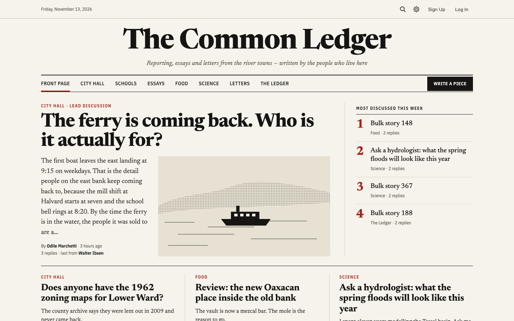
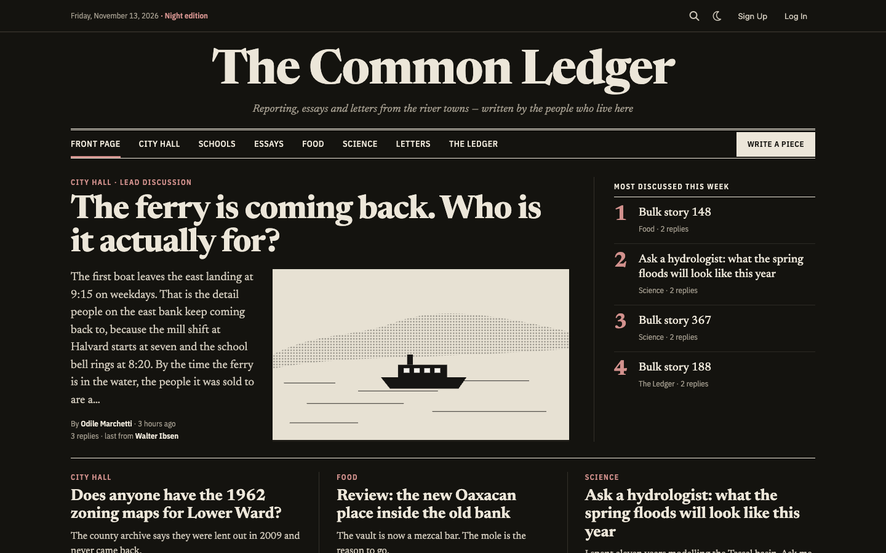
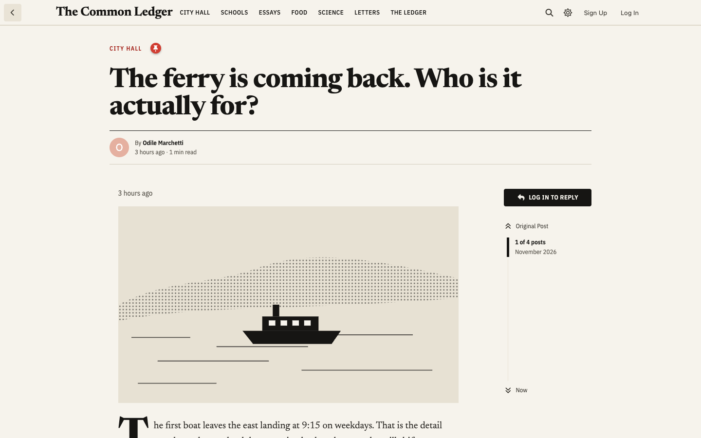
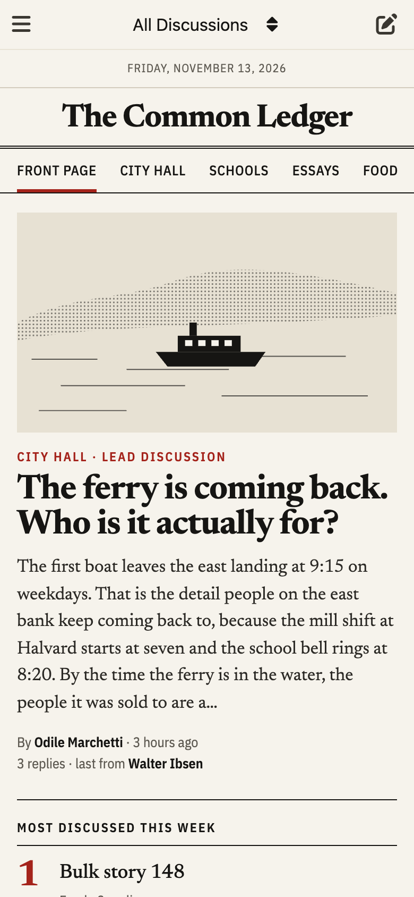
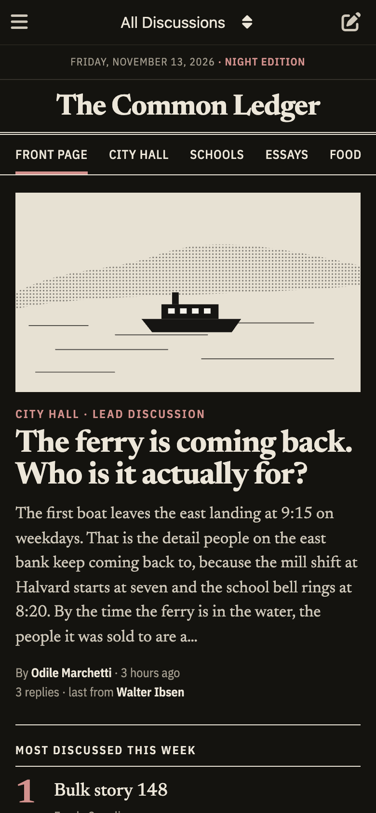
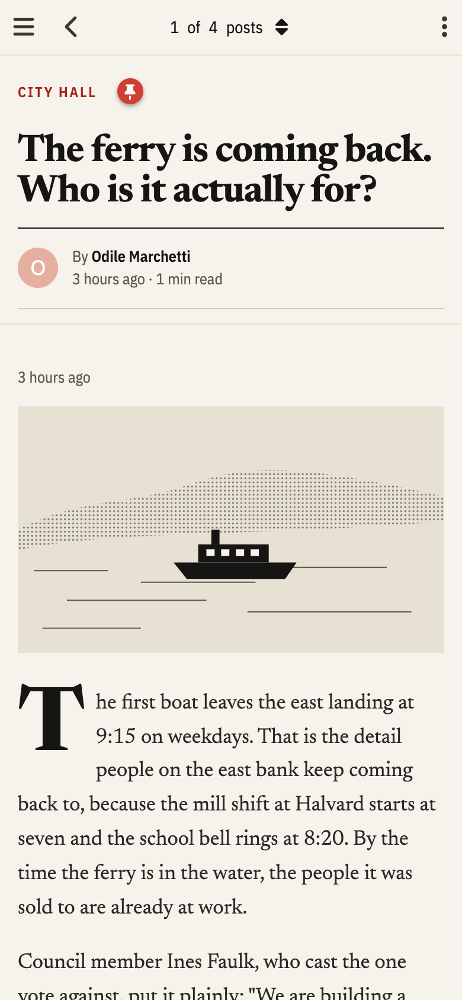
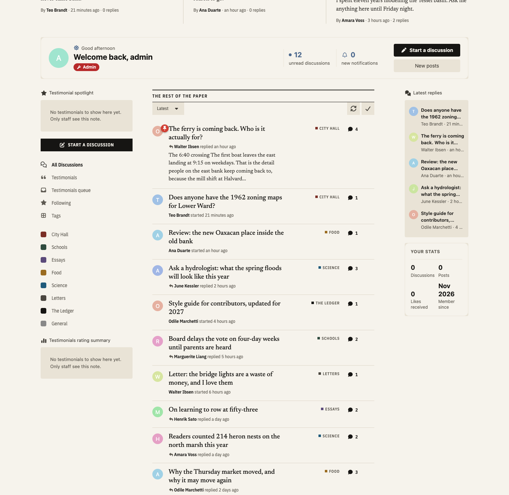

# Broadsheet

A newspaper front-page theme for Flarum 2, for news and writing communities.

- **A nameplate** — your paper's name set large across the top, with a tagline and today's date.
- **A section nav built from your tags** — pick the tags, or leave it to your primary tags.
- **A front page** — a lead story (the newest, the newest sticky or the most-liked discussion), the week's most discussed in serif numerals, and three stories in ruled columns. Core's discussion list stays below it as "The rest of the paper", with its sorting, sidebar and every extension's list items.
- **Discussions that read like articles** — a headline and byline, a drop cap, quotes pulled out between rules, and replies under "Letters in reply".
- **A Night edition** — Flarum's dark mode, set in ink and newsprint.







| Phone | Phone, Night edition | A discussion on a phone |
| --- | --- | --- |
|  |  |  |

Typeset in Newsreader and IBM Plex Sans Condensed, served from your own forum (no Google Fonts).

## Install

```sh
composer require ernestdefoe/broadsheet
```

Then enable **Broadsheet** in your admin panel. Settings: nameplate, tagline, the date line, how the lead story is picked, the section tags, the accent color and the fonts.

## Works with

Tags, Sticky, Likes, Mentions, fof/upload, Scribe and [Wardrobe](https://github.com/ernestdefoe/wardrobe) (members choose their theme). Widgets placed with fof/forum-widgets-core show in all five of its areas around the front page (Homecoming, Latest Replies and Testimonials below).



## Licence

MIT. Fonts: SIL Open Font License (see `assets/fonts`).

☕ [Buy me a coffee](https://buymeacoffee.com/ernestdefoe)
